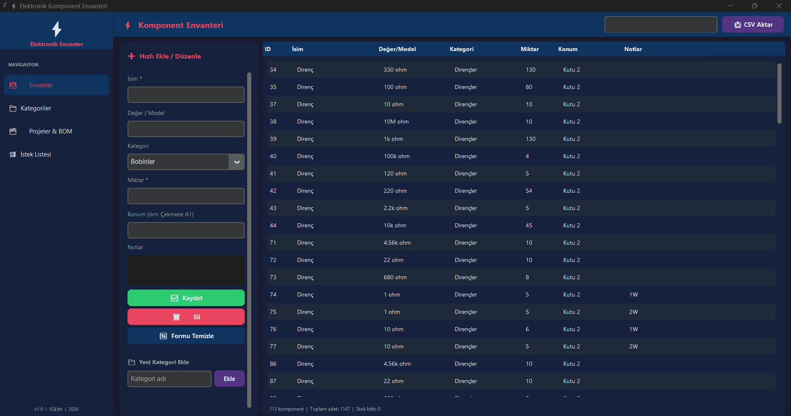

# ⚡ Elektronik Komponent Envanteri

Elektronik parçalarını (direnç, kapasitör, entegre, bobin…) takip etmek için
Python + **customtkinter** ile yazılmış, koyu temalı bir masaüstü uygulaması.
Tüm veriler bilgisayarındaki yerel bir **SQLite** veritabanında tutulur. İnternet
bağlantısı ya da hesap gerekmez.



## Özellikler

- **Envanter:** Komponentleri isim, değer/model, kategori, miktar, konum
  (ör. *Çekmece A1*) ve notlarla kaydet. Hızlı ekle/düzenle paneli, arama ve
  alt kısımda özet (komponent sayısı, toplam adet, stoğu biten parçalar) var.
- **Kategoriler:** Kategori ekle, yeniden adlandır, sil; her kategorideki
  parçaları ayrı gör.
- **Projeler & BOM:** Projeler oluştur, her projeye malzeme listesi (BOM) ekle.
  Kullandığın parçaları tek tıkla **stoktan düş**, gerekirse **iade et**.
- **İstek Listesi:** Almak istediğin parçaları not al.
- **CSV Aktar:** Envanteri Excel'de açılabilen bir CSV dosyasına yedekle.

## Kurulum

Gereksinim: **Python 3.10+** (Windows'ta denendi).

```bash
git clone https://github.com/H1potenus/Elektronik_Envanter.git
cd Elektronik_Envanter
pip install -r requirements.txt
python elektronik_envanter.py
```

Windows'ta komut yazmak istemezsen:

1. `Kurulum.bat` dosyasına çift tıkla (yalnızca bir kez).
2. Sonra her seferinde `Baslat.bat` ile aç.

> **İpucu:** Kullanıcı adında Türkçe karakter (ğ, ş, ı…) varsa projeyi
> `C:\Elektronik_Envanter` gibi doğrudan C:\ altındaki bir klasöre koy.

## Veriler

- Veritabanı (`inventory.db`) ilk açılışta, programın bulunduğu klasörde
  otomatik oluşturulur. Varsayılan kategoriler hazır gelir.
- Yedek almak için `inventory.db` dosyasını kopyalaman ya da **CSV Aktar**
  düğmesini kullanman yeterli.
- Kişisel envanter dosyaları (`*.db`, `*.csv`, `*.pdf`) `.gitignore` ile
  depodan hariç tutulur.
